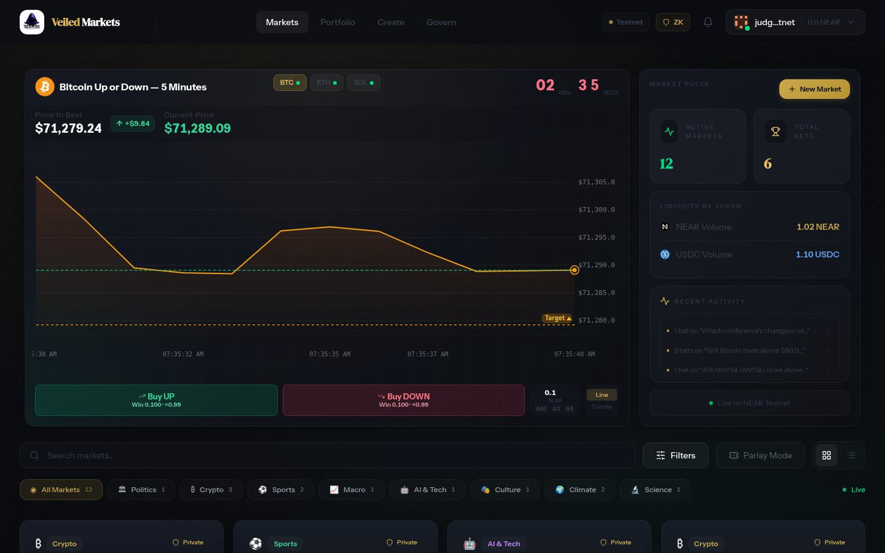
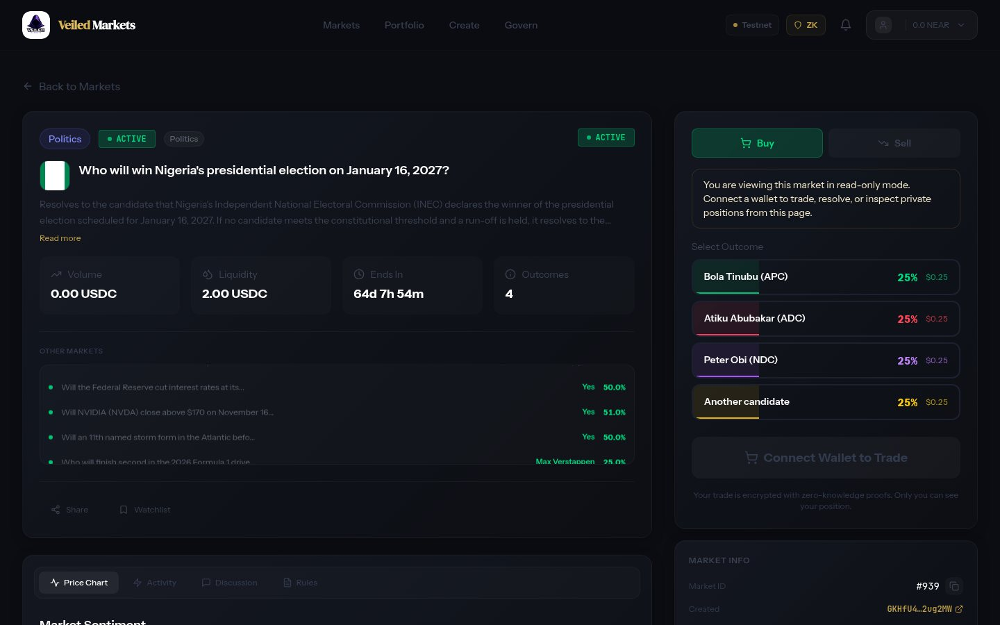

<div align="center">


# Veiled Markets

A prediction market on NEAR where prices are public and positions are private.

[**Live demo**](https://veiledmarkets.xyz) · [Demo video](https://x.com/MDLOG_labs/status/2121134799658328102) · [Contract](https://testnet.nearblocks.io/address/v1.veiled-markets.testnet) · [Design](docs/near/DESIGN.md) · [Resolution rules](docs/near/RESOLUTION.md) · [Try it](#try-it) · [Run it locally](#run-it-locally)


</div>

| | |
|---|---|
| **Event** | NEAR HACKATHON, 1 to 14 November 2026 |
| **Track** | Privacy & Private AI (private finance) |
| **Live demo** | <https://veiledmarkets.xyz>, on NEAR testnet with test tokens only |
| **Demo video** | [Post on X](https://x.com/MDLOG_labs/status/2121134799658328102): a 2.5-minute walkthrough of a deposit and a private bet, filmed live on testnet |
| **Contract** | [`v1.veiled-markets.testnet`](https://testnet.nearblocks.io/address/v1.veiled-markets.testnet) |
| **Built in the hackathon** | The NEAR contract, the zero-knowledge circuit, the relayer, the turbo oracle and the app's NEAR layer. The product existed on Aleo before: see [Hackathon disclosure](#hackathon-disclosure). |

## What it is

**The problem.** On a public chain a bet is tied to the account that placed it. Anyone can read what an account
holds, copy it or trade against it, and for some questions (an election, an employer, a court case) the bet itself
is information its owner does not want published.

**The product.** Veiled Markets is a prediction market where the market stays public and the bettor does not. Prices,
pool sizes and every trade's market, outcome and amount are on chain for anyone to check. Which account holds which
position is not: a trade is proven in the browser with a zero-knowledge proof and submitted by a relayer, so the
bettor's account never signs it.

It has:

- **Markets with two to four outcomes**, priced at all times by an on-chain market maker, in NEAR or USDC.
- **Turbo rounds**: BTC, ETH or SOL up or down over five minutes, opened and settled by an oracle that logs every
  price it used.
- **Parlays** of two to four outcomes across markets, priced by the contract from the live pools.
- **Liquidity provision**, with a fee on every sell going to the pool.
- **Resolution** by bonded vote, a dispute window, and a committee when a result is disputed, with no keeper: the
  first redeem settles the market and pays its first correct voter. See [How a market settles](#how-a-market-settles).

| Landing page | Dashboard | A market |
|---|---|---|
|  |  |  |

## Try it

The demo runs at <https://veiledmarkets.xyz> against NEAR testnet. Steps 1 and 2 need nothing. From step 3 you need
[Meteor Wallet](https://wallet.meteorwallet.app) (extension or web) with a testnet account and a little testnet NEAR
([near-faucet.io](https://near-faucet.io)).

| # | Do | See |
|---|---|---|
| 1 | Open <https://veiledmarkets.xyz>. | Live markets with their odds, read from the contract. No wallet is asked for. |
| 2 | Click **Try a 5-minute Turbo round**. | Live BTC, ETH and SOL prices, the open round's price to beat and its countdown. |
| 3 | Click **Launch app** and connect Meteor Wallet. | The dashboard: every open market, the number of active markets and the total of bets counted by the contract. |
| 4 | Open **Portfolio** and click **Unlock private balance (sign a message, no fee)**. Approve the signature in Meteor. | The private balance panel opens. No transaction is sent: the signature only derives the key that reads your notes. |
| 5 | Type `0.5` and click **Deposit**. Approve the transaction. | A public transfer from your account to the contract. The panel then shows a private balance of 0.5 NEAR. |
| 6 | Open a market, choose an outcome, type an amount and click **Buy … Shares**. | The browser builds a proof for a few seconds, then **Shares Purchased!** with a **View Transaction** link. No wallet prompt appears. |
| 7 | Follow **View Transaction** to NearBlocks. | The transaction is signed by `veiled-relayer.testnet`, not by your account. Its arguments name the market, the outcome and the amount, and no trader. |
| 8 | Return to **Portfolio**. | The position is listed under **Open Positions**. It is read from notes that only your browser can decrypt. |
| 9 | Sell the shares on the market page, then click **Withdraw** in the private balance panel. | NEAR arrives back in your account in a public transaction. |

For USDC markets, get test USDC from [faucet.circle.com](https://faucet.circle.com) (choose NEAR Testnet) and deposit
it the same way.

## How NEAR is used

- **One contract holds everything**: the note pool, the markets and their market maker, resolution, parlays and
  turbo rounds. A private action is a single call with no cross-contract step, so it either happens or does not.
- **Proofs are verified on chain** with NEAR's `alt_bn128` host functions (Groth16 on BN254). One private action
  costs about 67 TGas, which the relayer pays.
- **USDC is Circle's NEP-141 token.** Deposits and USDC markets enter through `ft_transfer_call`, handled by the
  contract's `ft_on_transfer`.
- **The key to a private balance comes from the wallet**: one NEP-413 `signMessage` signature, so the same wallet
  finds its notes again in any browser.
- **Named accounts separate the roles**: the contract, the relayer that submits private actions and the oracle that
  runs turbo rounds are three accounts with three keys.

Its place in the privacy track is private finance: hiding who holds a position while keeping the market itself
auditable. An optional AI resolver ([below](#ai-resolver-near-ai-cloud)) asks a model running in NEAR AI Cloud's TEE for
a market's result and casts an ordinary bonded vote with a signed, checkable receipt; it is built and tested but not
running on the hosted demo yet.

## How a bet stays private

A private balance and every position are **notes**: commitments in a Merkle tree inside the contract. Only the
browser that holds the key can read them.

1. **Deposit.** NEAR or USDC moves from your wallet into your private balance. This step is public.
2. **Trade.** The browser builds a zero-knowledge proof that you own enough notes and sends it to the relayer, which
   submits it. Your account does not sign the trade.
3. **Withdraw.** Funds move back to any NEAR account. This step is public.

| Public on NEAR | Private |
|---|---|
| Deposits and withdrawals, with account and amount | Which account holds which position |
| Market prices and pool sizes | Your balance inside the pool |
| Each trade's market, outcome and amount | Who placed each trade |
| Resolution votes and bonds | Your trading history |

Deposit before you trade. When a private balance is too small, the app tops it up from the wallet at the moment of
the trade, and that timing links the trade to the account.

The note key is derived from the wallet's signature, so a new browser recovers the same balance. A wallet that cannot
sign messages gets a key kept only in that browser, which the app asks the user to back up; a declined signature is an
error, never a silent fallback.

## How a market settles

Nobody has to run a keeper, and no transaction is needed just to move a market along. Each stage takes effect when
its window ends:

1. **Vote.** After trading closes, anyone votes for an outcome with a 0.1 NEAR bond, optionally with a link to their
   evidence. The first vote opens a 15-minute vote window and fixes the dispute deadline one hour after it.
2. **Counted.** When the vote window ends with enough voters, the outcome with the most bonded NEAR is the result.
3. **Dispute window.** For an hour anyone can dispute with 3× the bonds posted; the committee then decides. Without a
   dispute the result is final when the hour ends.
4. **Settled.** The contract's views already show the market as resolved. The next call that touches it (in practice
   the first winner's redeem, or anyone's `settle_market`) writes the result on chain, slashes the losing bonds, and
   pays the market's **resolver** in the same transaction: the first voter of the winning outcome gets their bond back
   plus half the market's protocol fees, with nothing to claim.

A market with no vote counted by its resolution deadline, or a dispute the committee leaves undecided for 24 hours, is
cancelled the same way, and every position and bond is refunded. The written standard that voters, disputers and the
committee apply is in [docs/near/RESOLUTION.md](docs/near/RESOLUTION.md).

**Who resolves today, honestly.** Anyone can vote, but on testnet most votes so far come from the team's own
accounts, and the five committee accounts are all run by the operator. One 0.1 NEAR vote decides a market that nobody
disputes within the hour. That is a demo setting; [Known limits](#known-limits) says what production needs.

### AI resolver (NEAR AI Cloud)

`backend/src/near-ai-resolver.ts` is an optional first voter. When a market's trading closes, it fetches the
resolution source the market names (it can only read a source given as a URL; with any other source the model has
nothing to read and abstains), then asks a model that runs inside NEAR AI Cloud's TEE (default
`z-ai/glm-5.3-flash`) which outcome the source supports under the market's rules. It votes only when:

- the model answers with confidence of at least 0.8, and
- NEAR AI's model TEE signed `model:sha256(request):sha256(response)` over the exact bytes, with a key listed in the
  hardware attestation the resolver fetched, with a fresh nonce, just before asking.

The vote's evidence is a link to a receipt (question, source excerpt, request, response, reasoning, signature and
attestation) plus the receipt's SHA-256, so anyone can check the receipt has not changed and re-verify the signature in
NEAR AI's Verification Center. The resolver has no special power: its vote is an ordinary bonded vote, and a wrong one
is disputed and decided by the committee like any other. It votes as `ai.veiled-markets.testnet` (created and funded
from the testnet faucet), so its votes are easy to tell from the team's own accounts. Its NEAR AI Cloud path
(attestation, signed answer, signature check) has run with a live key, but it is not running on the hosted demo yet.

## Architecture

```
Browser (React)
  └─ frontend/src/lib/near/
       ├─ wallet   NEAR Wallet Selector (Meteor Wallet)
       ├─ reads    contract views
       ├─ notes    scans and decrypts the user's notes, builds the Merkle path
       └─ prover   snarkjs Groth16 proof in a web worker
            │ proof + action
            ▼
Relayer (backend/src/near-relayer.ts) ── transact ──▶ Contract v1.veiled-markets.testnet
                                                        ├─ note pool: depth-20 Poseidon tree, nullifiers
Turbo oracle (backend/src/near-turbo-oracle.ts)          ├─ markets: FPMM market maker, liquidity, fees
  opens and settles five-minute rounds           ──▶    ├─ resolution: votes, disputes, committee,
                                                        │    settled by the first call that touches a market
AI resolver (backend/src/near-ai-resolver.ts)    ──▶    └─ parlays, turbo rounds and their vault
  optional: NEAR AI Cloud (TEE) reads the source,
  casts a bonded vote with a signed receipt
```

The relayer checks each proof locally before it spends gas on it, and it cannot change a trade: the proof binds the
action, the recipient and the fee. The full design is in [docs/near/DESIGN.md](docs/near/DESIGN.md).

### Deployed on NEAR testnet

| What | Where |
|---|---|
| Contract | [`v1.veiled-markets.testnet`](https://testnet.nearblocks.io/address/v1.veiled-markets.testnet) |
| Relayer account and service | [`veiled-relayer.testnet`](https://testnet.nearblocks.io/address/veiled-relayer.testnet), <https://relayer.veiledmarkets.xyz> |
| Turbo oracle account and service | [`veiled-oracle.testnet`](https://testnet.nearblocks.io/address/veiled-oracle.testnet), <https://oracle.veiledmarkets.xyz> ([audit log](https://oracle.veiledmarkets.xyz/audit)) |
| USDC | Circle's testnet token, `3e2210e1184b45b64c8a434c0a7e7b23cc04ea7eb7a6c3c32520d03d4afcb8af` |

Testnet settings: the vote window is 15 minutes, the dispute window an hour, the committee's time limit 24 hours and
the vote bond 0.1 NEAR, so a market nobody disputes resolves 1 h 15 min after its first vote. A buy pays 1% (half to
the market's creator, half to the protocol); a sell pays that plus 1% to liquidity providers.

## Run it locally

Requirements: Node.js 20 or newer. Rust is needed only for the contract tests.

**The app, against the deployed contract and the hosted relayer and oracle:**

```bash
git clone https://github.com/hevDev7/veiled-markets-near.git
cd veiled-markets-near/frontend
npm install
VITE_RELAYER_URL=https://relayer.veiledmarkets.xyz \
VITE_TURBO_ORACLE_URL=https://oracle.veiledmarkets.xyz \
npm run dev            # http://localhost:3100
```

Then follow [Try it](#try-it) with `http://localhost:3100` in place of the demo address.

**Your own relayer and oracle** (optional; each needs the key of a funded testnet account):

```bash
cd backend && npm install
RELAYER_PRIVATE_KEY=ed25519:… npm run relayer                                  # port 4100
ORACLE_PRIVATE_KEY=ed25519:…  npm run turbo-oracle -- --serve --auto-create    # port 4090
cd ../frontend && npm run dev          # without the two VITE_ variables it uses localhost:4100 and :4090
```

The oracle reads Pyth Hermes when `backend/.env` has `PYTH_API_KEY`, otherwise CoinGecko. `NEAR_RPC_URL` accepts a
comma-separated list for the relayer, the oracle and the scripts. The relayer submits to the contract named by
`VEILED_CONTRACT`, and only the account the contract names as its oracle operator can open or settle turbo rounds.

**Your own contract:** build the wasm and run `near/scripts/deploy-testnet.sh v2`. Rebuilding the circuit
(`cd near/circuits && npm run build`, which needs `circom`) makes new proving keys, so it goes with a new contract.

**A whole market lifecycle in about an hour and a half** (operator keys needed): `cd backend && npx tsx
scripts/quick-market.ts create 6` opens a NEAR price question for the first five-minute mark at least six minutes
away, with CoinGecko's price series around that moment as its source, so the AI resolver can decide it. To vote
yourself, `npx tsx scripts/quick-market.ts resolve <id> <1=Yes|2=No>` casts the bonded vote. The result is final 1 h 15 min later
with no further call, and the first winner to redeem privately in the app settles the market and pays the voter. The
other scripts are listed in [backend/README.md](backend/README.md).

**The AI resolver** (a NEAR AI Cloud key in `backend/.env` as `NEARAI_API_KEY`, and a funded account):
`cd backend && DRY_RUN=1 npm run ai-resolver -- --once` decides every market waiting for a vote and writes the receipts
to `backend/ai-receipts/` without voting. With `AI_RESOLVER_ACCOUNT` and `AI_RESOLVER_PUBLIC_URL` set (the address where
its `/receipts` are served), `npm run ai-resolver` votes and serves the receipts.

## Tests

| What | Command | Expect |
|---|---|---|
| Circuit: valid spends prove, invalid ones do not | `cd near/circuits && npm install && node --test test/spend.test.mjs` | 6 pass |
| Contract rules, with a mocked host | `cd near/contract && cargo test -p veiled` | 73 pass |
| Contract in a NEAR sandbox, with real proofs | `cd near/contract && cargo test -p integration-tests` | 12 pass |
| Relayer request checks, AI resolver decisions and TEE signature checks, LP note bookkeeping, demo price questions | `cd backend && npm install && npm test` | 33 pass |
| App: note keys, wallet signature, market data, positions, math, resolution stages | `cd frontend && npm install && npm test` | 70 pass |
| Live testnet: deposit, then a relayed private withdrawal | `cd backend && npx tsx scripts/testnet-smoke.ts <account> https://relayer.veiledmarkets.xyz` | needs that account's key |

The sandbox tests download a NEAR sandbox binary on first run, and the in-place upgrade test among them is skipped
unless `VEILED_WASM_OLD` points at the previously deployed wasm.

## Repository layout

```
near/contract/        Rust contract (near-sdk): note pool, markets, market maker, resolution, parlays, turbo
near/circuits/        Circom spend circuit, its key build, Node proving helpers and tests
near/scripts/         deploy and upgrade scripts
backend/              relayer, turbo oracle and operator scripts (backend/README.md)
frontend/             React app; the NEAR layer is frontend/src/lib/near/
sdk/                  TypeScript SDK from the Aleo product; the app still imports its market maker math
docs/near/            DESIGN.md and the screenshots above
docs/README-aleo.md   README of the Aleo product, archived
```

## Hackathon disclosure

### Built before the hackathon, and what is new

Veiled Markets already existed as a product on **Aleo**, built before this hackathon. Its README is kept at
[docs/README-aleo.md](docs/README-aleo.md). For the hackathon it was ported to NEAR: the pages and components are the
same, and NEAR now supplies the data, the wallet and the private trading that Aleo supplied before.

| | Where |
|---|---|
| **New:** zero-knowledge circuit (Groth16 note pool) | `near/circuits/` |
| **New:** NEAR contract (note pool, markets, market maker, resolution, parlays, turbo) | `near/contract/` |
| **New:** relayer, turbo oracle, AI resolver and operator scripts | `backend/src/near-relayer.ts`, `backend/src/near-turbo-oracle.ts`, `backend/src/near-ai-resolver.ts`, `backend/scripts/` |
| **New:** the app's NEAR layer (wallet, chain reads, prover, notes) | `frontend/src/lib/near/` |
| **New:** private balance panel, landing page, account pictures and NEAR wording in the app | `frontend/src/components/` |
| **Baseline:** React pages and components, market maker math, the SDK | the rest of `frontend/` and `sdk/` |

The two are separated in git. Tag [`pre-hackathon`](https://github.com/hevDev7/veiled-markets-near/tree/pre-hackathon)
is the Aleo product as it stood before the hackathon, and tag `hackathon-submission` is this submission. The diff:
[pre-hackathon...hackathon-submission](https://github.com/hevDev7/veiled-markets-near/compare/pre-hackathon...hackathon-submission)
(locally: `git diff pre-hackathon hackathon-submission`).

The Aleo programs, their deploy scripts and their documents are no longer in the working tree, because the NEAR app
does not use them. They are unchanged in history and at the `pre-hackathon` tag. Some app code still carries Aleo
names (`aleo-client.ts`, for example): the pages read data in the shape they always did, and the NEAR layer answers
those reads.

### Libraries and tools

| Part | Third-party code |
|---|---|
| Contract | `near-sdk` 5.30.1, `ark-bn254` and `ark-ff` 0.5 (field arithmetic); tests with `near-workspaces` 0.24 |
| Circuit | Circom 2.1.6, `circomlib` 2.0.5, `circomlibjs` 0.1.7, `snarkjs` 0.7.5, and the public Perpetual Powers of Tau |
| App | React 18, Vite 5, TypeScript 5, Tailwind CSS 3, Framer Motion 11, React Router 6, Zustand 4, Recharts 3, `lucide-react`, NEAR Wallet Selector 10.1.4 with its Meteor Wallet module, `@near-js/transactions`, `snarkjs`, `poseidon-lite` |
| Services | `near-api-js` 7.3.1, `snarkjs`, `tsx`, `@noble/curves` and `@noble/hashes` 2.2.0 (TEE signature checks); turbo prices from Pyth Hermes, or CoinGecko without a Pyth key; the AI resolver calls NEAR AI Cloud's OpenAI-compatible API |
| Hosting | Docker images on Railway; the app is served by Caddy |

The team's own pre-hackathon code is the baseline listed above. Parts of the code were written with the help of AI
coding assistants.

### The submitter's other project

The same person also submits [**YieldForge**](https://github.com/mdlog/yieldforge) (live at
<https://yieldforge.mdloglabs.org>), which splits Meta Pool stNEAR into principal and yield tokens. The two projects
are independent: they share no code, contracts or accounts (rule Q-015).

## Known limits

What the testnet deployment trusts, and what a production deployment still needs:

- **Resolution.** A market resolves by bonded vote, then a dispute window, then (if disputed) a committee of five
  accounts the operator runs, so the team decides every dispute. On testnet one voter is enough and the bond is
  0.1 NEAR, so one account can decide a market unless someone disputes within the hour. The first correct voter is
  paid half the market's protocol fees, which is small on testnet markets; forfeited bonds go to the treasury, not to
  correct voters. Production needs a larger bond, more voters (`set_resolution_config`), and a committee the operator
  does not control. The AI resolver's model and signature are checked, but the source page it reads is fetched by the
  resolver itself, outside the TEE.
- **Cancelled markets.** A cancelled market refunds each outcome what its buyers paid in, pro rata within that
  outcome, so a refund cannot draw on another outcome's collateral. Markets created before that rule keep the older
  pro-rata refund.
- **Parlay pool.** Leg odds are read from the markets' own pools, which anyone with capital can move. Only markets the
  owner approved can be legs, and one ticket pays at most 1% of its thinnest leg's pool depth. The pool is
  operator-funded risk capital, not a guaranteed product.
- **Turbo rounds.** Bets close for the last fifth of a round, because a shared pool cannot fairly take bets when the
  result is all but known. The oracle operator supplies the baseline and the closing price; the contract checks the
  operator and the price bounds.
- **Storage and capacity.** Every private action adds two leaves and two nullifiers (about 700 bytes) that the
  contract pays for from its own NEAR, and the note tree holds 524,288 actions in total. A production deployment needs
  a storage fee per action and a deeper or rotating tree.
- **Private balance key.** The key is derived from a wallet signature and kept in the browser's storage. Sign the key
  message only on veiledmarkets.xyz.
- **Privacy.** Amounts are public; what is hidden is which account holds which position. A deposit made right before
  a bet can be linked to it by timing.
- **Operator keys.** The contract account still has a full-access key and can be redeployed by the operator.
- **Trusted setup.** The circuit key comes from a single phase-2 contribution on top of the public Perpetual Powers
  of Tau. A mainnet launch needs a multi-party ceremony.
- **Relayer.** The relayer pays gas and charges nothing on testnet. A production relayer would charge a fee.
- **Audit.** The code has not been audited.

### Not on NEAR yet

Governance proposals and resolver staking exist only in the Aleo product. The app hides their controls on NEAR.
(Resolver rewards are on NEAR now, paid per market from its protocol fees.)

## License

[MIT](LICENSE)
